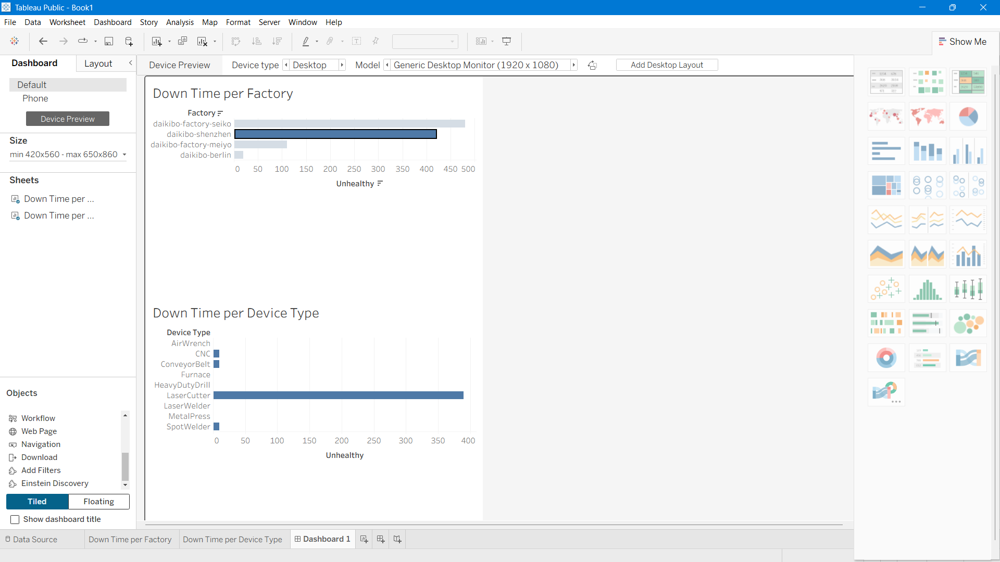

# Deloitte Australia - Data Analytics Job Simulation 📊

## Overview
This project was completed as part of the **Deloitte Australia Data Analytics Job Simulation** on Forage (July 2026).

The task involved analyzing telemetry data from Daikibo's 4 factories to identify which factory had the most machine downtime and which machines were breaking the most.

## Problem Statement
Daikibo collected telemetry data from 4 factories:
- Daikibo Factory Meiyo (Tokyo, Japan)
- Daikibo Factory Seiko (Osaka, Japan)
- Daikibo Berlin (Berlin, Germany)
- Daikibo Shenzhen (Shenzhen, China)

**Questions to answer:**
1. Which factory had the most machine downtime?
2. Which machine type broke the most in that factory?

## Key Findings 🔍
- **Factory with most downtime:** Daikibo Shenzhen (China)
- **Machine that broke the most:** LaserCutter

## Dashboard

## Tools Used
- **Tableau** — Data visualization and dashboard creation
- **Microsoft Excel** — Forensic data classification (Task 2)

## Skills Demonstrated
- Data Analysis
- Data Visualization
- Tableau Dashboard Creation
- Forensic Technology
- Pattern Recognition in Manufacturing Data

## Certificate
Completed and certified by Deloitte Australia via Forage — July 2026

## Author
**Nikhil Solanki**
BTech Final Year | AI & Data Science
GitHub: https://github.com/nikhilsolanki02
LinkedIn: https://www.linkedin.com/in/nikhil-solanki5128
