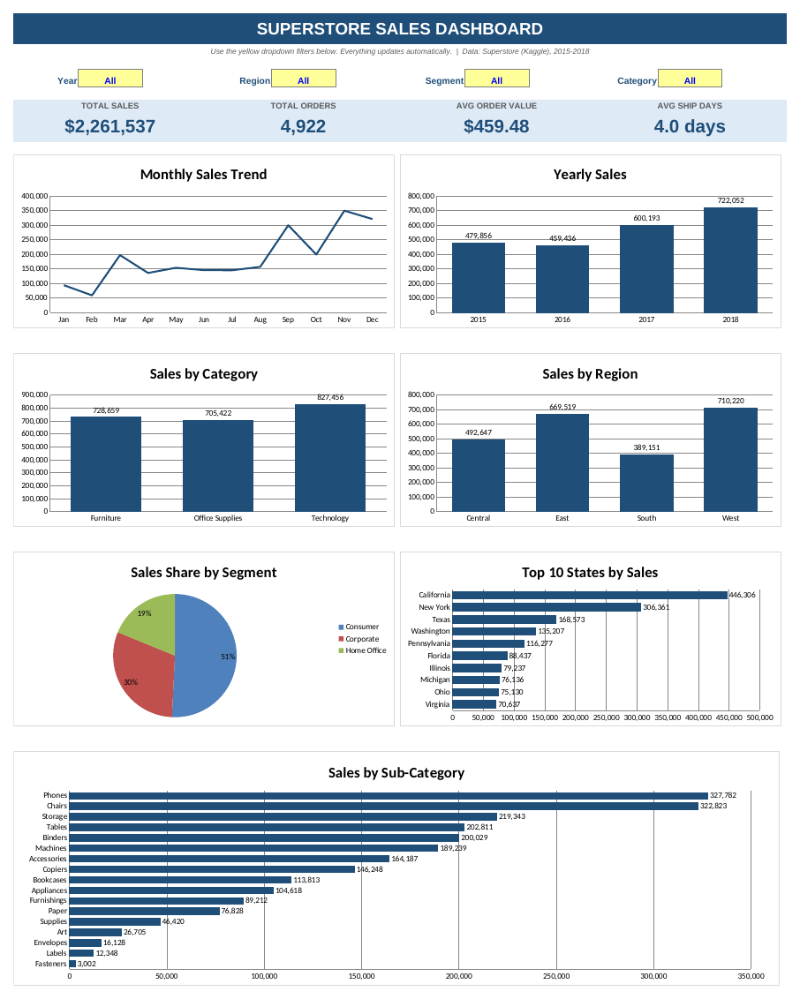

# Superstore Sales Analysis (Excel Dashboard)

An interactive Excel dashboard analyzing 4 years of Superstore retail sales (2015-2018) to find which categories, regions, segments and months drive revenue.



## Problem Statement
Which products, regions and customer segments generate the most sales, and how does sales change over time? What should the business focus on?

## Dataset
- Source: Superstore Sales Dataset (Kaggle), `train.csv`
- 9,800 rows, 18 columns, 4,922 unique orders, 2015-2018
- **Note:** this version has no Profit column, so the analysis is based on **Sales** only.

## Tools
Microsoft Excel: Excel Tables, formulas (SUMIFS, AVERAGEIFS, COUNTIF), dropdown filters, charts.

## Data Cleaning
- Converted `Order Date` and `Ship Date` from text (dd/mm/yyyy) to real dates
- Filled 11 missing Postal Codes (all Burlington, Vermont) with `05401`; stored postal codes as 5-digit text
- Checked for duplicates (0 found)
- Added helper columns: `Year`, `Month`, `Month No`, `Ship Days`, `New Order` (flag used to count distinct orders)

## Dashboard Features
- 4 KPIs: Total Sales, Total Orders, Average Order Value, Average Ship Days
- Dropdown filters: Year, Region, Segment, Category (all KPIs and charts update together)
- 7 charts: monthly trend, yearly sales, category, region, segment share, top 10 states, sub-category

## Key Insights
| KPI | Value |
|-----|-------|
| Total Sales | $2,261,537 |
| Total Orders | 4,922 |
| Avg Order Value | $459.48 |
| Avg Ship Days | 4.0 |

1. **Sales growth:** After a small dip in 2016 (-4.3%), sales grew +30.6% in 2017 and +20.3% in 2018. 2018 sales are about 50% higher than 2015.
2. **Seasonality:** September, November and December together bring about 43% of yearly sales. February is the weakest month.
3. **Category:** Technology leads (36.6%), followed by Furniture (32.2%) and Office Supplies (31.2%).
4. **Sub-category:** Phones and Chairs are the top two (about 29% combined). Fasteners, Labels and Envelopes contribute very little.
5. **Region:** West and East bring about 61% of sales. South is the weakest region (17%).
6. **Segment:** Consumer customers generate about 51% of sales, Corporate 30%, Home Office 19%.
7. **Geography:** California and New York alone account for about 33% of total sales.

## Recommendations
- Plan inventory and marketing campaigns ahead of Sep-Dec, and run promotions to lift low months (Jan-Feb).
- Invest more in Technology and Furniture (Phones, Chairs, Storage) since they drive revenue.
- Study why the South region lags and test targeted campaigns there.
- Grow the Corporate segment, which has high-value bulk-order potential.

## Project Structure
```
superstore-sales-analysis/
├── original_csv_file/
│   └── train.csv
├── superstore_clean.xlsx
├── dashboard_screenshot.png
└── README.md
```

## How to Use
Open `data/superstore_clean.xlsx`, go to the **Dashboard** sheet and use the yellow dropdown filters.
